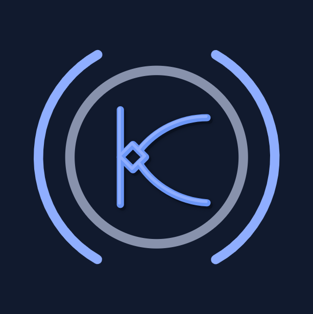

<p align="center">
  <a href="https://kryzect.vercel.app/">
    
  </a>
</p>

<h1 align="center">Kryzect</h1>

<p align="center"><strong>Think First. Build Better.</strong></p>

<p align="center">
  Software engineering, AI, and automation built around what your business actually needs.<br />
  Founder-led in Lahore, Pakistan. Working remotely.
</p>

<p align="center">
  <a href="https://kryzect.vercel.app/">Live Website</a>
  &nbsp;·&nbsp;
  <a href="#getting-started">Getting Started</a>
  &nbsp;·&nbsp;
  <a href="#project-structure">Project Structure</a>
  &nbsp;·&nbsp;
  <a href="https://kryzect.vercel.app/contact">Start a Project</a>
</p>

<p align="center">
  <a href="https://react.dev/"></a>
  <a href="https://vite.dev/"></a>
  <a href="https://reactrouter.com/"></a>
  <a href="https://nodejs.org/"></a>
</p>

<p align="center">
  
  <a href="https://oxc.rs/"></a>
  <a href="https://playwright.dev/"></a>
  <a href="https://kryzect.vercel.app/"></a>
</p>

<p align="center">
  <a href="https://github.com/Kryzect/Kryzect-Official-Website/actions/workflows/quality.yml"></a>
</p>

---

## About

The official website for Kryzect, a founder-led software engineering and AI company. We build websites, digital products, business software, AI systems, and connected workflows, starting with the business problem and an agreed scope.

> **Clarity before code.** Understand the work, define the scope, and build something useful.

The website introduces our services, Express and Strategic engagements, founder, and product experiments. Work and Blog are implemented and remain hidden from navigation until genuine content is published.

## Tech stack

| Layer      | Technology                                                       |
| ---------- | ---------------------------------------------------------------- |
| Interface  | React 19, JavaScript, JSX                                        |
| Build      | Vite 8 and static HTML generation                                |
| Routing    | React Router 7 with lazy page loading                            |
| Styling    | Plain CSS, shared components, and design tokens                  |
| Typography | Self-hosted Bricolage Grotesque, Public Sans, and JetBrains Mono |
| Enquiries  | Web3Forms with validation, timeout handling, and email fallback  |
| Booking    | Google Calendar appointment scheduling through an external link  |
| Quality    | Oxlint, Prettier, Node.js tests, Playwright, and axe             |
| Hosting    | Vercel, clean static URLs, and a custom 404                      |

The visual system lives in [`src/styles/tokens.css`](src/styles/tokens.css): a dark background (`#0A1120`), blue accent (`#8FAEFF`), and shared spacing, typography, and surface tokens. Dependency versions are recorded in [`package-lock.json`](package-lock.json).

## Getting started

Use **Node.js 24**, matching [`.nvmrc`](.nvmrc) and CI.

```bash
npm ci
npm run dev
```

Build and preview the production output:

```bash
npm run build
npm run preview
```

The production preview runs at **http://127.0.0.1:4173**. It serves the generated pages and headers locally; it does not verify Vercel account settings.

## Scripts

| Command                | Purpose                                                                  |
| ---------------------- | ------------------------------------------------------------------------ |
| `npm run dev`          | Start the Vite development server                                        |
| `npm run build`        | Build assets, static HTML, sitemap, robots, and the custom 404           |
| `npm run preview`      | Serve the production output locally                                      |
| `npm run lint`         | Run Oxlint with warnings treated as failures                             |
| `npm test`             | Run form, metadata, and publication checks                               |
| `npm run test:browser` | Check Chromium layouts, accessibility, navigation, and form interactions |
| `npm run check`        | Run lint, unit tests, and the production build                           |
| `npm run format`       | Format source, scripts, tests, and configuration                         |
| `npm run format:check` | Check formatting without modifying files                                 |

For browser checks, first build the site and install Chromium:

```bash
npm run build
npx playwright install chromium
npm run test:browser
```

Alternatively, set `CHROME_PATH` to an existing Chrome executable. CI installs Chromium in its runner. Automated form checks intercept submissions and do not send real enquiries.

## Project structure

```text
.github/             # Quality workflow and dependency updates
docs/                # Operations and publishing guides
public/              # Original logo, social share image, and font licenses
scripts/             # Build, static rendering, preview, generation, and checks
src/
├── components/      # Navigation, brand animation, forms, metadata, and shared UI
├── data/            # Services, products, content, and publication policy
├── pages/           # Route components and future publishing templates
├── styles/          # Design tokens, logo animation, and shared page styles
├── utils/           # Contact and article helpers
├── App.jsx          # Application routes
├── entry-server.jsx # Static rendering entry
└── main.jsx         # Browser hydration and client entry
tests/               # Form and publication regression tests
vercel.json          # Static URL behavior and security headers
```

## Content and publishing

Public identity and integration settings live in [`src/config.js`](src/config.js). The page registry in [`src/data/site-map.js`](src/data/site-map.js) controls navigation and indexability; content records drive generated routes and the sitemap.

Add real projects and articles to their content records. Empty Work and Blog sections stay out of navigation and search indexing. The build validates publication records, including slugs, article dates, and image metadata.

See the [publishing guide](docs/PUBLISHING.md) for content requirements and release checks.

## Deployment and quality

The live website is hosted at **[kryzect.vercel.app](https://kryzect.vercel.app/)**.

The build renders known routes to static HTML and generates `sitemap.xml`, `robots.txt`, and `404.html`. React hydrates the pages for client navigation. There is no production rendering server or catch-all SPA rewrite.

GitHub Actions checks formatting, lint, unit tests, the build, dependency advisories, credential signatures, and browser behavior. WCAG 2.2 AA is a working target; automated checks supplement keyboard and visual review.

Fonts are served locally under their bundled licenses. No visitor analytics are configured. To recreate the social share image, select a browser as above and run:

```bash
node scripts/generate-share-card.mjs
```

See the [operations guide](docs/OPERATIONS.md) for provider setup, real enquiry delivery checks, security headers, and release verification.

## Contact

[Start a project](https://kryzect.vercel.app/contact) · [Book a call](https://kryzect.vercel.app/book-a-call) · [LinkedIn](https://www.linkedin.com/company/kryzect)

---

<p align="center">
  <sub>Kryzect · Think First. Build Better.</sub>
</p>
